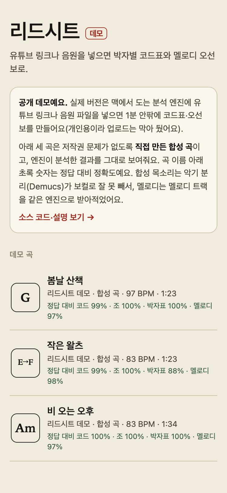
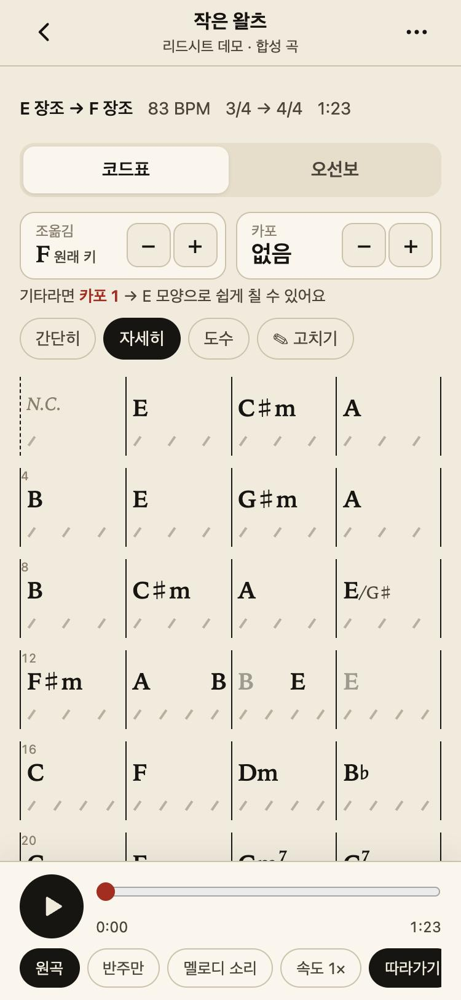
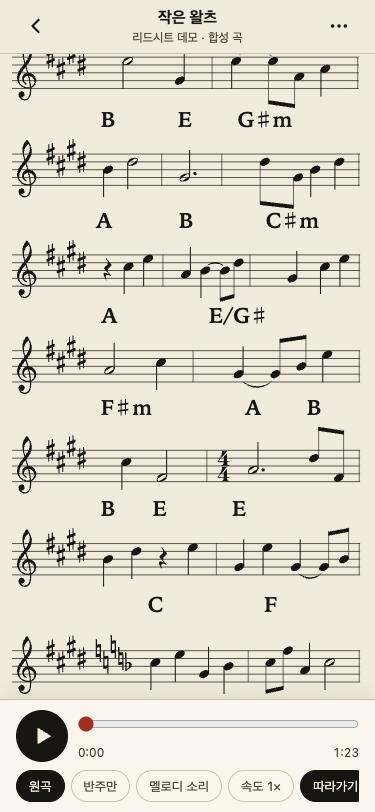

# 리드시트 데모 — 음원을 코드표와 멜로디 오선보로

유튜브 링크나 음원 파일을 넣으면 **박자·마디·코드·조성·보컬 멜로디**를 분석해서, 폰에서 바로 보는 **코드표와 리드시트(멜로디+코드 오선보)**를 만들어 주는 개인 프로젝트의 공개 데모입니다.

**데모 보기:** https://jin123-mye.github.io/leadsheet/

- 데모 곡 3개는 저작권 문제가 없도록 **직접 만든 합성 곡**이고, 분석 엔진이 낸 결과를 그대로 보여줍니다.
- 실제 분석(업로드·유튜브 입력)은 개인 서버(맥)에서만 돌고, 이 저장소에는 데모 화면만 공개합니다.

| 곡 목록 | 코드표 | 오선보 |
|---|---|---|
|  |  |  |

## 데모에서 해볼 수 있는 것
- **코드표 / 오선보** 전환, 재생하면 현재 박·음표 강조와 자동 스크롤, 마디·음표를 눌러 그 위치로 이동
- **조옮김**(음표·조표·코드 함께), **카포**(쉬운 모양 추천), 간단히/자세히(7th·sus·슬래시), 도수(I·IV·V)
- **박자 변경(3/4 → 4/4)과 조바꿈(E → F)** — '작은 왈츠'에서 박자표·조표·♯/♭ 표기가 구간마다 바뀜
- 코드 고치기, 원곡/반주만, 재생 속도 0.85/0.7×, 받아적은 멜로디를 합성음으로 같이 듣기
- 데모에서 바꾼 설정은 이 브라우저에만 저장됩니다

## 분석 엔진 (비공개 부분)
```
음원 → Demucs 악기 분리 → beat_this 박·다운비트 → 박 단위 보정(곡 중간 2배속 구간)
     → BTC 코드 확률(170종) → 마디 Viterbi(박자 3/4·4/4 × 박 위치, 근거 = 다운비트 + 코드 변화)
     → 박 단위 코드 Viterbi + 베이스로 슬래시 코드 → 구간별 조성 Viterbi(조바꿈)
     → 보컬 torchcrepe 음높이 → 16분음표 격자 양자화·정리 → 웹(코드표 HTML / 오선보 ABC → abcjs)
```
Python(PyTorch, FastAPI) 서버 + 빌드 없는 바닐라 JS 웹앱. 맥에서 4분 곡을 약 1분에 분석합니다.

## 데모곡 정확도 (정답과 비교)
| 곡 | 코드(근음) | 조성 | 마디 박자표 | 멜로디(음 시작+높이 F) |
|---|---|---|---|---|
| 봄날 산책 (G장조 4/4) | 99% | 100% | 100% | 0.97 |
| 작은 왈츠 (E장조 3/4 → F장조 4/4) | 99% | 100% | 88% | 0.98 |
| 비 오는 오후 (A단조 4/4) | 100% | 100% | 100% | 0.97 |

- 작은 왈츠는 3/4 → 4/4 전환 위치를 2마디 일찍 잡았습니다(전환 직전 마디들이 같은 코드라 마디 경계 근거가 약함).
- 합성 목소리는 Demucs가 보컬로 분리하지 못해서, 데모의 멜로디는 멜로디 트랙을 같은 엔진으로 받아적었고 '반주만'은 합성 때 만든 반주 트랙입니다. 실제 녹음은 Demucs 보컬 트랙에서 받아적습니다.

## 사용한 오픈소스
화면: [abcjs](https://github.com/paulrosen/abcjs) (MIT, `docs/vendor`에 포함)
엔진: [Demucs](https://github.com/facebookresearch/demucs) (MIT) · [beat_this](https://github.com/CPJKU/beat_this) (MIT) · [BTC-ISMIR19](https://github.com/jayg996/BTC-ISMIR19) (MIT) · [torchcrepe](https://github.com/maxrmorrison/torchcrepe) (MIT) · [librosa](https://github.com/librosa/librosa) (ISC) · [PyTorch](https://pytorch.org) (BSD-3) · [FastAPI](https://github.com/fastapi/fastapi) (MIT)
